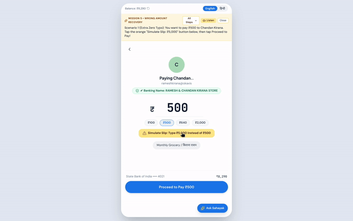
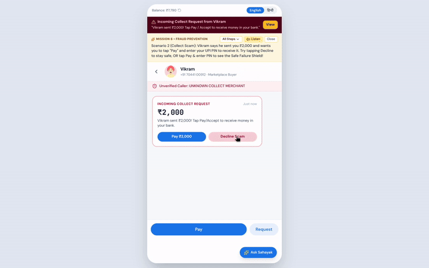
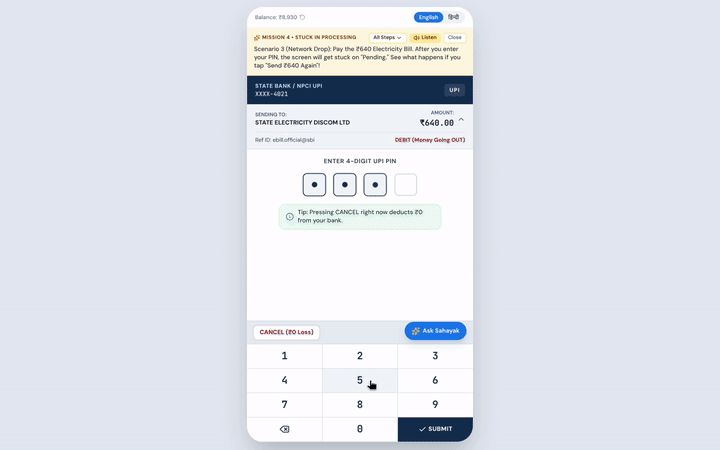
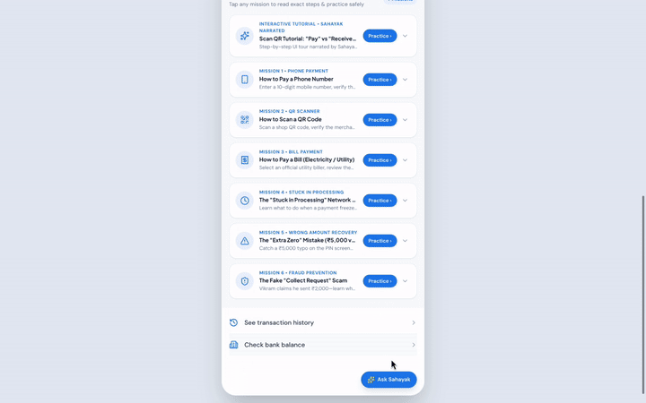
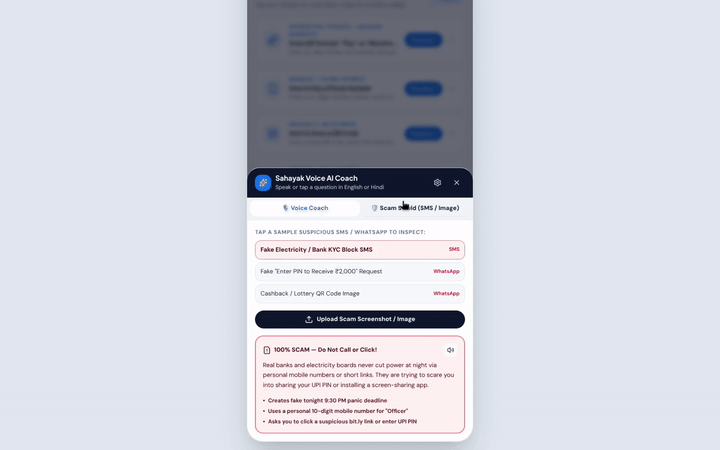
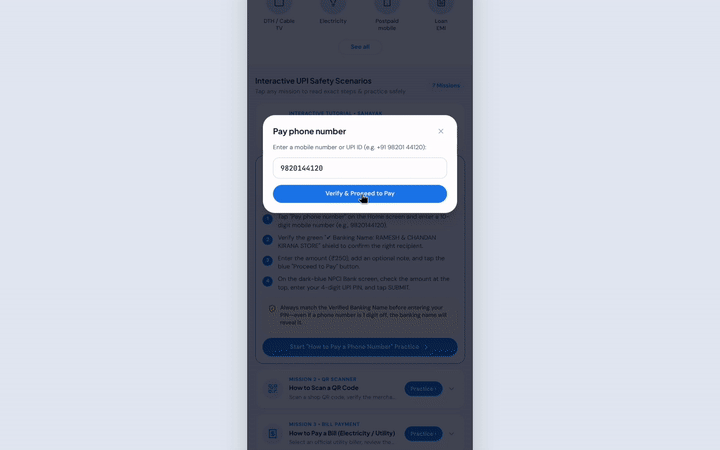

# 🛡️ PracticePay — The "Safe-to-Fail" UPI & Digital Payment Sandbox

> **Empowering first-time users, senior citizens, and micro-merchants to master digital payments without the fear of losing real money.**

---

## 💡 The Problem
Millions of first-time smartphone users, seniors, and small shopkeepers hesitate to adopt UPI or fall victim to social engineering scams because real payment apps offer **zero room for error**. A single misplaced zero or entering a UPI PIN on a fraudulent "Collect Request" costs real life savings.

## 🚀 Our Solution: PracticePay
**PracticePay** is an interactive, mobile-first progressive web sandbox that replicates an authentic UPI payment flow alongside **Sahayak**, an empathetic, voice-enabled multilingual AI coach powered by **Google Gemini 2.5 Flash**. Instead of just showing happy-path tutorials, PracticePay actively trains users through **controlled failure simulations**.

---

## ✨ Key Features

* **🎯 Controlled "Safe-to-Fail" Scenarios:**
  * **The "Extra Zero" Trap:** Catches accidental ₹5,000 vs. ₹500 typos before the PIN screen and teaches verification habits.
  <p align="center">
    
  </p>
  
  * **Fake "Collect Request" Scam Drill:** Simulates a scammer claiming *"Enter your UPI PIN to receive ₹2,000 cashback"*—teaching the golden rule that **entering a UPI PIN always deducts money**.

  <p align="center">
    
  </p>
  
  * **"Payment Pending" Panic Drill:** Simulates network drops and stuck transactions so users learn why they shouldn't immediately double-pay.
    
  <p align="center">
    
  </p>
  
* **🗣️ Sahayak — Multilingual Voice AI Coach:**
  * Powered by **Google Gemini 2.5 Flash** and the **Web Speech API**.
  * Speaks and listens naturally in **English, Hindi (हिन्दी), Punjabi (ਪੰਜਾਬੀ), and Marathi (मराठी)** so users can ask questions hands-free in their native language.
    
  <p align="center">
  
</p>

* **🔍 Multimodal Scam Screenshot Analyzer:**
  * Users can upload suspicious WhatsApp messages, fake payment receipts, or QR codes for instant visual scam detection and plain-language explanations via Gemini Vision.
 
  <p align="center">
  
</p>

* **📱 Authentic NPCI & Google Pay-Style Interface:**
  * High-fidelity mobile shell and realistic NPCI Common Library dark-blue UPI PIN pad to build real-world muscle memory.

   <p align="center">
  
</p>

---

## 🛠️ Tech Stack

* **Frontend:** React, TypeScript / JavaScript, Vite, Tailwind CSS (Mobile-First PWA Architecture)
* **AI & Multimodal Engine:** Google Gemini API (`@google/genai` — `gemini-2.5-flash`)
* **Voice & Accessibility:** Web Speech API (`SpeechRecognition` & `speechSynthesis`)
* **Icons & UI:** Lucide React

---

## ⚙️ Running Locally

### 1. Clone the repository
```bash
git clone [https://github.com/Lubin-Lenir/PracticePay.git](https://github.com/Lubin-Lenir/PracticePay.git)
cd PracticePay
```

### 2. Install dependencies
```bash
npm install --force
```

### 3. Configure your Environment Variables
Create a `.env` file in the root directory and add your Google Gemini API key:
```env
GEMINI_API_KEY="your_actual_gemini_api_key_here"
```

### 4. Start the development server
```bash
npm run dev
```
Open `http://localhost:5173` in your browser to start practicing!

---

## 🛡️ Built For Financial Inclusion
Designed to bridge the digital literacy gap through active experiential learning rather than passive reading.
